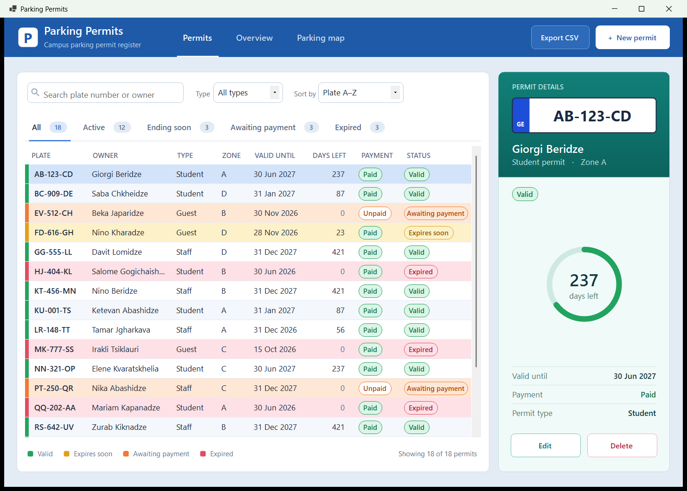
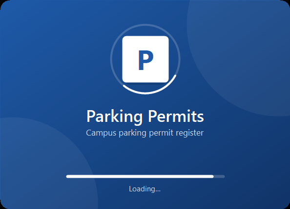
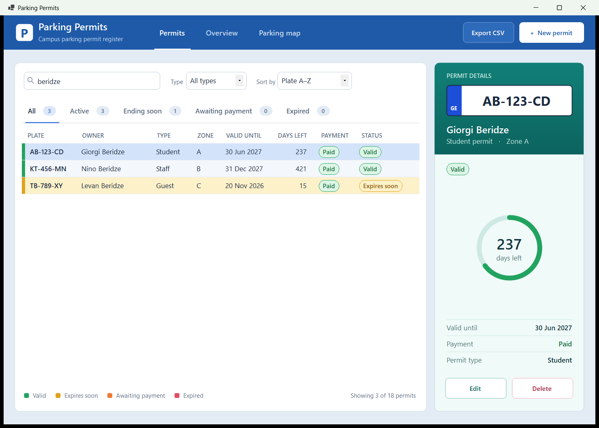
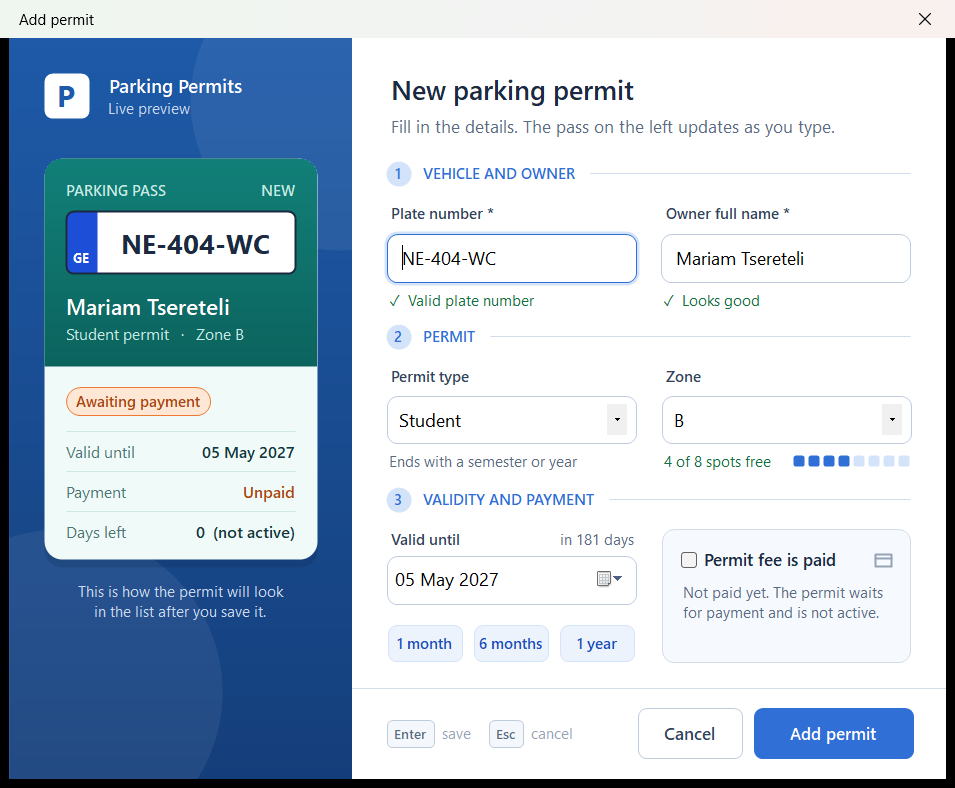
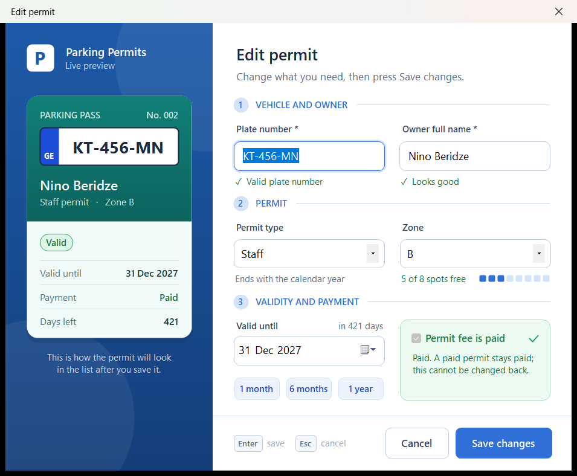
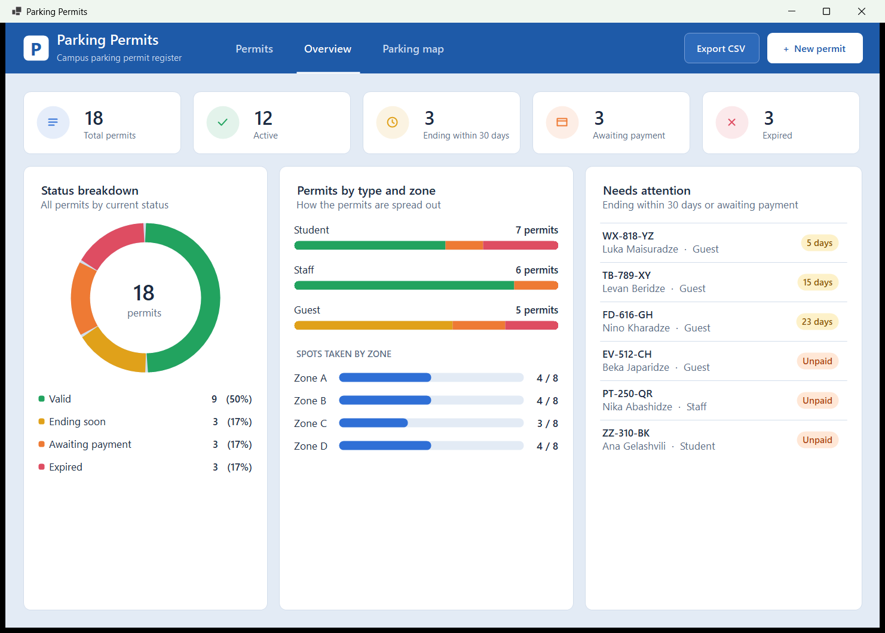
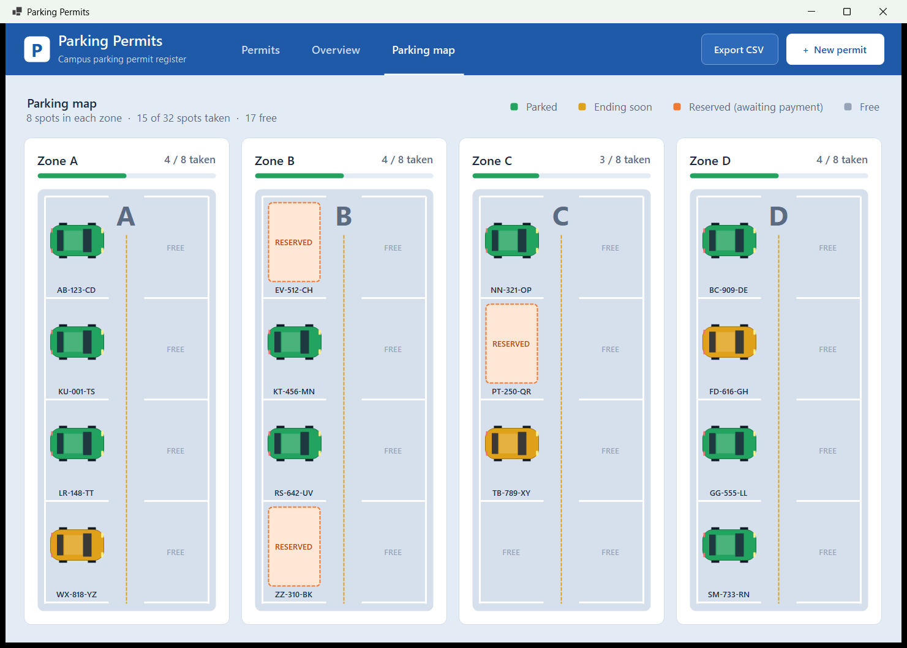

# 🅿️ Parking Permits

A Windows Forms app (C# · .NET 10 · SQL Server LocalDB) for managing a university's parking permits.
You can **list, search, filter, sort, add, edit and delete** permits, see an **overview dashboard**,
and look at a **drawn parking map** that shows which spots in each zone are taken.

---

## Contents
1. [How to run it](#how-to-run-it)
2. [Features](#features)
3. [The database table](#the-database-table)
4. [Rules the app enforces](#rules-the-app-enforces)
5. [Project files](#project-files)
6. [Manual test: Export to CSV](#manual-test-export-to-csv)

---

## How to run it

1. In Visual Studio 2026: **View → SQL Server Object Explorer**
2. Right-click **(localdb)\MSSQLLocalDB → New Query**
3. Paste the contents of `ParkingPermits/database.sql` and press **Execute**
4. Open `ParkingPermits.sln`
5. **Build → Rebuild Solution**, then press **F5**

> The script can be run more than once: it only creates what is missing and inserts the 18 test permits only into an empty table.

---

## Features

### Loading screen

When the app starts, a short loading screen (about two seconds) shows the logo with a turning ring and a loading bar, then the main window opens.

### Permits page: find a permit and act on it

| Area | What it does |
|---|---|
| **Search box** | Finds permits by plate number *or* owner name while you type |
| **Type** | Shows only Student, Staff or Guest permits (works together with search) |
| **Sort by** | Plate A–Z · Owner A–Z · Expiring first · Expiring last |
| **Status tabs** | All · Active · Ending soon · Awaiting payment · Expired, each with a live count |
| **Coloured rows** | 🟩 valid · 🟨 ends within 30 days · 🟧 awaiting payment · 🟥 expired |
| **Details panel** | The selected permit: number plate, owner, status, a "days left" ring, Edit and Delete |

A search for **beridze** finds exactly three permits:

### Adding and editing a permit

**+ New permit** opens an empty dialog. **Edit** (or a double-click on a row) opens the same dialog
already filled in. A preview of the number plate updates as you type.
**Enter** saves and **Esc** cancels.

| Add | Edit |
|---|---|
|  |  |

After every add, edit or delete, a green notice confirms it in the top bar, and the grid, tabs,
overview and map update straight away. **Delete** always asks *Yes / No* first.

### Overview page: the big picture

Summary cards, a status chart, permits by type, spots taken in each zone, and a **Needs attention**
list of permits ending soon or waiting for payment. Click one to open it.

### Parking map page: who is parked where

Each zone is drawn as a car park with **8 spots**. A paid permit is a car (yellow when it ends within
30 days), an unpaid one is a dashed **reserved** spot, and the rest are **free**.
Hover over a spot to see who holds it; click it to open the permit.

### Export to CSV

**Export CSV** saves the rows currently shown in the grid to a `.csv` file (UTF-8, opens correctly in Excel).
It only **reads** the list: nothing in the database is changed, added or deleted.

A sample export of all 18 permits (as of 5 Nov 2026) is in [`exports/permits-export.csv`](exports/permits-export.csv).

---

## The database table

**Database:** `ParkingPermitsDb` · **Table:** `Permits`

| Column      | Type          | Notes                                   |
|-------------|---------------|-----------------------------------------|
| Id          | INT IDENTITY  | primary key                             |
| PlateNumber | NVARCHAR(20)  | searched · format `AB-123-CD`           |
| OwnerName   | NVARCHAR(100) | searched · English first and last name  |
| PermitType  | NVARCHAR(20)  | Student / Staff / Guest · the filter    |
| Zone        | NVARCHAR(10)  | A / B / C / D                           |
| ValidUntil  | DATE          | last day the permit can be used         |
| IsPaid      | BIT           | whether the permit fee is paid          |

The `Permit` class also has **calculated properties** that are not stored in the database:

| Property | Meaning |
|---|---|
| `IsExpired` | the end date has passed |
| `IsActive` | paid **and** not expired, so the permit can be used |
| `TakesSpot` | not expired, so it holds a parking spot |
| `DaysLeft` | days the permit can still be used (0 if expired or unpaid) |
| `ExpiresSoon` | active and ends within 30 days |
| `Validity` | Valid · Expires soon · Awaiting payment · Expired |
| `Payment` | Paid · Unpaid |

---

## Rules the app enforces

**In the Add / Edit dialog** (a message explains the problem and the dialog stays open):
- Plate number is required and must look like `AB-123-CD`, and no two permits may share a plate.
- Owner is required and must be a first and last name in English letters, e.g. *Nino Beridze*.
- A new permit cannot end in the past, and no permit can run more than 2 years ahead.
- A zone with no free spot is refused: *"Zone C is full (8 of 8 spots taken)"*.
- Once a permit is paid, the *paid* box is locked.

**In the database:**
- A paid permit can never be changed back to unpaid; the trigger `trg_Permits_PaidCannotBeUndone` refuses it.

**Everywhere:**
- Everything the user types reaches SQL Server as a **parameter**, never as part of the SQL text.
  Searching for `' OR 1=1 --`, `%` or `_` finds nothing and causes no error.
- Every zone has the same number of spots, set in one place: `ParkingLot.SpotsPerZone` (8).
  A permit holds its spot until it expires.

> **Expiring first / last:** permits that can be used now come first, sorted by end date,
> then permits awaiting payment, then expired ones.

---

## Project files

| File | What is in it |
|---|---|
| `database.sql` | creates the database, the table and the trigger, and inserts 18 test permits |
| `Permit.cs` | one row of the table, plus the calculated properties |
| `PermitRepository.cs` | **all** the SQL: search, add, update, delete, plate and spot checks |
| `ParkingLot.cs` | the zones and the number of spots per zone |
| `MainForm.cs` | main window: list, buttons, grid colours, details panel |
| `MainForm.Pages.cs` | page tabs, status tabs and the Overview page |
| `MainForm.Map.cs` | the Parking map page |
| `PermitForm.cs` | the Add / Edit dialog and its checks |
| `SplashForm.cs` | the loading screen shown before the main window |
| `GraphicsHelper.cs` | colours and drawing: icons, badges, number plate, ring, cars |
| `Panels.cs` | `BufferedPanel` (no flicker) and `CardPanel` (white rounded card) |
| `RoundedButton.cs` | button with rounded corners and a smooth hover effect |

---

## Manual test: Export to CSV

Everything else was tested automatically. The Windows **Save** dialog could not be, so check it by hand:

| # | Do this | Expected result |
|---|---------|-----------------|
| 1 | Permits page, no search, tab **All** → **Export CSV** → save as `all.csv` on the Desktop | Green notice *"18 permits exported to all.csv."* (same number as *"Showing … permits"*) |
| 2 | Open `all.csv` in Excel | Header row: Plate number, Owner, Permit type, Zone, Valid until, Days left, Payment, Status; one row per permit, each value in its own column |
| 3 | Look at *Valid until* and *Days left* | Dates look like `2027-06-30`; expired and unpaid permits have 0 days left |
| 4 | Search `beridze`, type **Staff**, export as `filtered.csv` | Only the shown row is saved (KT-456-MN) |
| 5 | Click the **Expired** tab, export as `expired.csv` | Only the expired permits are saved |
| 6 | Search `nothing-matches` → **Export CSV** | *"There are no rows to export."* and no Save dialog |
| 7 | **Export CSV** → **Cancel** in the Save dialog | Nothing is saved and no green notice appears |
| 8 | Keep `all.csv` open in Excel and export over it | *"The file could not be saved. Is it open in Excel?"*, and the app keeps working |

Delete the test CSV files from the Desktop afterwards.
